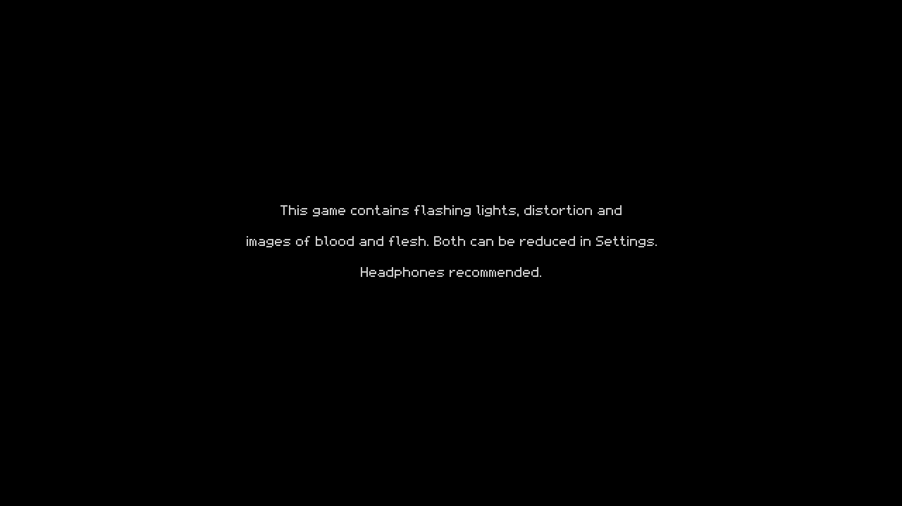

# 观测日志 · OBSERVATION LOG

2D 横板像素恐怖游戏 · Godot 4.7.2 · 修复版 1.0.1（2026-11-12）

> 原始版本由 **Claude Opus 5.5**（opencode）制作；后续修复记录见 `docs/REPAIR_LOG.md`。断点日志：`docs/BREAKPOINT.md`。
> 旧的网页 demo 与旧 Godot 版（均在此工程之外的本机旧目录中）原样保留未动，仅作备份。

## 在线试玩（Web / Cloudflare Pages）

**现在就能玩：<https://observation-log-9t9.pages.dev>**（手机能打开，但游戏是键盘操作，请用电脑浏览器）

重新部署：

```powershell
npm install
npm run build:web      # Godot → dist/（wasm 压缩到 9.7 MB，满足 Pages 的 25 MiB 单文件上限）
npx wrangler login     # 仅第一次
npm run deploy         # → https://observation-log-9t9.pages.dev
```

首次加载约 38 MB，慢网 10–30 秒；之后走长缓存。键盘操作，建议横屏/桌面浏览器。
部署细节、排错与自查清单见 [`docs/DEPLOY.md`](docs/DEPLOY.md)。

浏览器里实际跑起来的样子（Playwright 自动截图，1280×720）：




## 开发与测试（一页看全）

| 目的 | 命令 | 耗时 |
| --- | --- | --- |
| 静态门禁 | `npm run check:static` | < 1 s |
| 单元测试（正典、双语文案、音频总线、产物契约） | `npm run test:unit`（= `npx vitest run`） | < 1 s |
| 单元测试（零依赖备用） | `npm run test:unit:node`（= `node --test`） | < 1 s |
| Godot 集成测试（星历、结局、菜单、行走、UFO、三条通关） | `npm run test:game` | 8–12 min |
| 浏览器 E2E（本地或线上） | `npm run test:e2e` | ~1.5 min |
| 本地预览 Web 构建 | `npm run serve` → http://127.0.0.1:8788 | — |
| 本地模拟 Cloudflare | `npx wrangler pages dev dist --port 8789` | — |

线上地址同样跑同一套 E2E：

```powershell
$env:GAME_URL = 'https://observation-log-9t9.pages.dev'
npx playwright test
```

课堂演示顺序见 [`docs/SHOWCASE.md`](docs/SHOWCASE.md)；agent 用的浏览器 MCP 配置在 [`opencode.json`](opencode.json)。

## 这个版本新增的文档

| 文件 | 内容 |
| --- | --- |
| [`docs/plan.md`](docs/plan.md) | **构思与边界**：七款游戏 → 六种机制、我的改编与取舍、创作红线、真实的驳回来回、三个开放问题、据/推断/设、`/goal` |
| [`docs/plan-engineering.md`](docs/plan-engineering.md) | 第十周的**工程**计划：交付清单、非目标、工作分解、测试策略、风险 |
| [`docs/sources/`](docs/sources/) | 灵感来源 PDF（七款游戏与三篇文献）、早期脚本、修改建议、开发工作清单 |
| [`docs/architecture.md`](docs/architecture.md) | 渲染层栈、模式路由、日循环、存档、构建管线（Mermaid） |
| [`docs/architecture-explainer.html`](docs/architecture-explainer.html) | 同一套架构的单文件 HTML 示意图（双击即开） |
| [`docs/SHOWCASE.md`](docs/SHOWCASE.md) | 课堂六项演示的逐条口令与文件对应 |
| [`docs/DEPLOY.md`](docs/DEPLOY.md) | Cloudflare Pages 部署、排错、更新 |
| [`docs/user-feedback.md`](docs/user-feedback.md) | 反馈 → 修复 → 回归测试记录（内部 QA ＋ 两位组外真人实测，§3 已填） |
| [`docs/audio-diagnosis.md`](docs/audio-diagnosis.md) | 「网页版没声音」的完整排查与修复记录 |
| [`opencode.json`](opencode.json) | `@playwright/mcp` 配置：agent 自己读 DOM/控制台/截图 |
| [`AGENTS.md`](AGENTS.md) | 给 agent/接手指南：命令、约定、三个必踩坑 |
| [`questions.md`](questions.md) | 未决问题与已知限制 |

## 怎么玩

解压后双击 **`play.bat`**。启动器依次查找 `GODOT_EXE`、工程目录 / `engine/` 内的 Godot、PATH、WinGet 安装目录，不再绑定任何用户名。支持 Godot 4.6+。

如果未找到引擎，把 Godot Windows 可执行文件放进 `game/engine/`，或设置 `GODOT_EXE` 为完整路径。此压缩包是工程源码包，**不是免安装的独立 EXE**；要「下载就能玩」，用上面的 Web 版。

Linux 可运行：`godot --path . --import`，再运行 `godot --path .`。

| 按键 | 作用 |
| --- | --- |
| A / D（← →） | 左右走（主角固定在画面水平中心，其余一切 1:1 反向移动） |
| E（Enter / 空格） | 互动；独白加速 |
| W / S | 接线盒选线、小游戏换轨 |
| 鼠标 | 电脑桌面：双击图标、拖窗口、点按钮；键盘输入汇报 |
| Esc | 世界中＝暂停菜单；桌面上＝离开电脑；调天线时＝取消 |
| **F1–F7** | **开发者捷径：重开一局，直接从第 1–7 天开始**（跳过前面所有天；会清空当前存档） |

> F1–F7 是给开发/演示用的：`scripts/main.gd` 顶部 `const CHEATS := true`，改成 `false` 即彻底移除。行为由 `tests/cheat_test.tscn` 守着（`npm run test:game` 里叫 `cheat` 关卡）。

- 存档：每天开始自动存档（单槽位）。主菜单「继续」，暂停菜单「重新开始今天」。
- 设置：语言（English / 简体中文）、音量 4 路、强闪光（开/减弱）、画面扭曲（开/减弱）、全屏。首次启动按系统语言自动选择。
- 一周目约 40–60 分钟：序章车程 → 7 天 → 结局 → 主界面（通关后主界面才出现游戏名与一颗小红点）。

## 目录

```
game/
  play.bat              启动
  project.godot
  scenes/main.tscn      唯一主场景（全部节点由脚本搭建）
  scripts/
    main.gd             渲染层栈 + 输入分发
    flow/flow.gd        导演：每日步骤、全部门控、全部演出序列
    world/              横板世界：world / player / sky / weather / lake / drips / drive（序章）
    desktop/            XP 桌面与程序
    minigame/           The Gift of X
    ending/             Day7 结局大过场
    ui/                 overlay（独白/提示/日卡/红字/面板）、menu
    core/               PixelFont 位图字体、Ephemeris 星历、DrawLayer
    autoload/           G（状态/存档/设置/语言）、Txt + txt_zh（英/中文案）、Sfx（音频）
  shaders/              world（自研光照+血肉）、post（32 色调色板+抖动）、fx、crt、bloodstar
  assets/               全部由 tools/ 下脚本生成（美术、字体、音频、星历数据）
  tools/                Python 资产生成器、平衡模拟、patch.py、build_web.ps1 / deploy.ps1 / serve.js / check_static.js
  tests/                Godot 集成测试场景 + tests/unit（node:test）+ tests/e2e（Playwright）
  web/                  _worker.js（wasm 解压）、_headers —— 部署时拷进 dist/
  dist/                 npm run build:web 的产物（不提交）
  docs/                 BREAKPOINT、DESIGN、plan、architecture、DEPLOY、user-feedback、REPAIR_LOG
  AGENTS.md / questions.md
  CREDITS.md            第三方素材署名（字体 OFL、Astronomy Engine MIT）
```

## 自动化测试

四个入口，按「越快越先跑」排列：

```powershell
npm run check:static   # <1 s：res:// 引用、JSON、Web 预设、本机路径/密钥泄漏
npm test               # <1 s：正典常量、双语键、文案 id、dist 产物契约
npm run test:game      # 8–12 min：Godot 无头，星历 / 结局 / 菜单 / 行走 / 三条通关
npm run test:e2e       # ~1.5 min：Playwright，本地 dist 或线上 URL
```

Godot 侧也可用老入口：Windows 双击 `tests/run_all.bat`，或 `python tools/run_tests.py`。两者都会隔离测试存档与设置、把完整日志写到 `tests/_logs/`，任一门禁失败返回非零。

下面的场景是各测试实现；**直接启动测试场景会操作真实 `user://` 存档**，日常请使用上述隔离入口。

| 测试 | 内容 | 当前结果 |
| --- | --- | --- |
| `tests/check.tscn` | 全部脚本可编译 | 44 个文件 0 失败 |
| `tests/day5_test.tscn` | 第 5 天铁皮屋被人影碰到 → 同化结局 → 主界面从第 5 天重来 | 全过 |
| `tests/dream_test.tscn` | 梦境约 20 秒到教堂（撞不撞礁都一样）；HOMEWARD 2000 分到教堂、门不开、回主界面 | 全过 |
| `tests/ending_test.tscn` | 三结局判定：线索门槛 4/5/9/10、摩斯编号、年份、存档往返、中英文文案齐全 | 全过 |
| `tests/playthrough.tscn` | 完整通关：序章→Day1…Day7→结局→名单→CG→主界面，按玩家方式操作并逐拍断言；参数 `answers=… lang=en/zh route=bad/normal/good` | 献祭（英）277 项、修车绕回（中）270 项、逃离（英）296 项全过（2026-11-25 实测） |
| `tests/motion_test.tscn` | 强制行走：6 种帧间隔 × 4 段路程，验证不越过目标点 | 24 项全过 |
| `tests/menu_test.tscn` | 警告页→标题→暂停→重开当日→回标题→继续 | 全过 |
| `tests/ephem_test.tscn` | 星图精度（36 个日期，对照 Astronomy Engine） | 最大误差 0.006°（要求 <0.1°） |
| `tests/shots.tscn` | 各场景截图到 `tests/_shots/`（`set=base/desk/mini/end/lake/zh`） | — |
| `tests/unit/*.test.js` | 正典常量、双语键覆盖、文案 id、dist 契约 | 33 项全过 |
| `tests/e2e/smoke.spec.js` | 启动零报错、零 404、wasm 合法、输入有反应、手机视口 | 4 项全过 |
| `tools/sim_minigame.py` | 小游戏平衡模拟 | 见 docs/DESIGN.md §7 |

## 导出独立运行包

Web 版（推荐）：见文首 `npm run build:web` / `npm run deploy`，或 [`docs/DEPLOY.md`](docs/DEPLOY.md)。

桌面版：`export_presets.cfg` 提供 Windows x86_64、Linux x86_64、Web 三个预设，数据嵌入可执行文件。装好与引擎**版本完全一致**的导出模板后：

```text
godot --headless --path . --import
godot --headless --path . --export-release "Windows Desktop" builds/windows/ObservationLog.exe
godot --headless --path . --export-release "Linux" builds/linux/ObservationLog.x86_64
godot --headless --path . --export-release "Web" builds/web/index.html
```

先建立对应输出目录。Web 预设关掉了线程支持（不需要 COOP/COEP 头）。桌面 EXE 未在本次环境验证（缺 Windows 原生导出模板）。

## 重新生成资产

```
cd tools
python cg_process.py     # 结局插画：src/cg/*_raw.png -> assets/art/cg/（640x360）
python gen_audio.py story  # 只生成调查玩法新增的音效（不改动原有音频）
python palette.py        # 32 色调色板
python gen_font.py       # 英文 UI 字体 + 7 套畸变字；中文 UI 字体 + 7 套中文畸变字（读 txt_zh.gd 收集用字）
python gen_art.py        # 全部像素美术（world props interior char desk mini end）
python gen_audio.py      # 全部音效、环境音、4 首音乐
python ephem_export.py   # 星历数据（需 pip install astronomy-engine）
```

改完资产后必须重新导入一次（`play.bat` 启动时会自动 `--import`）。
