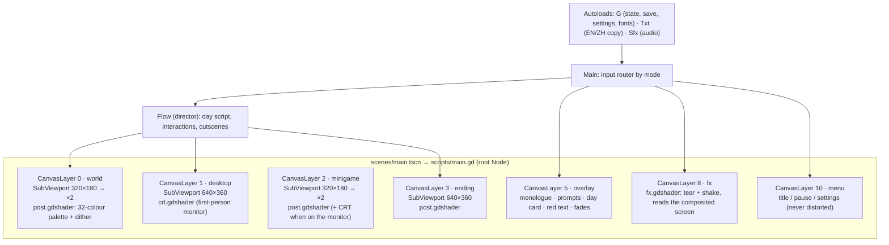
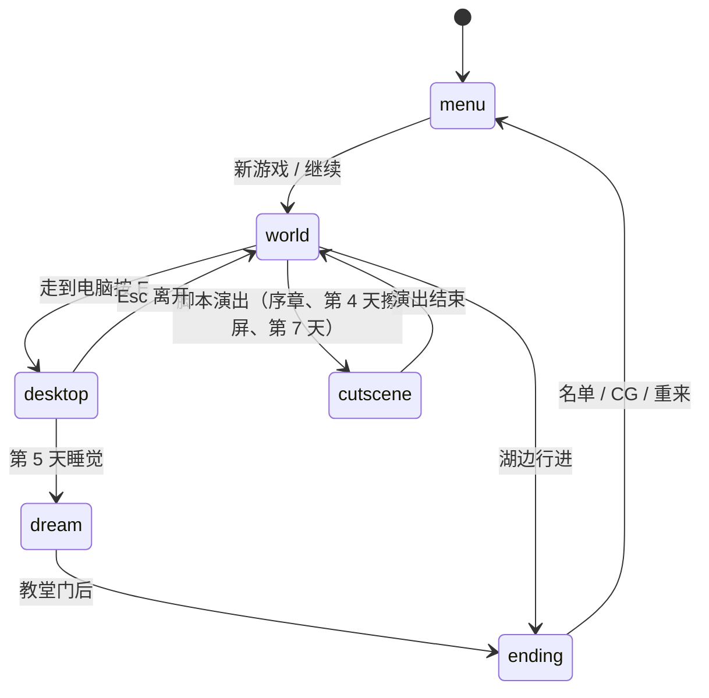
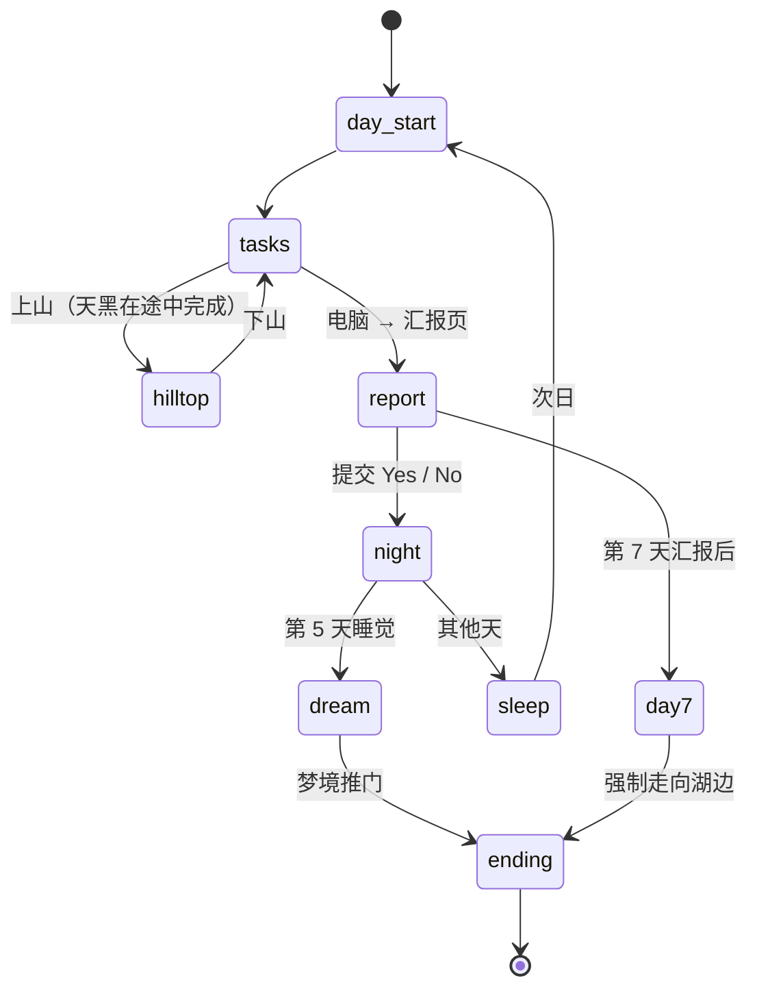
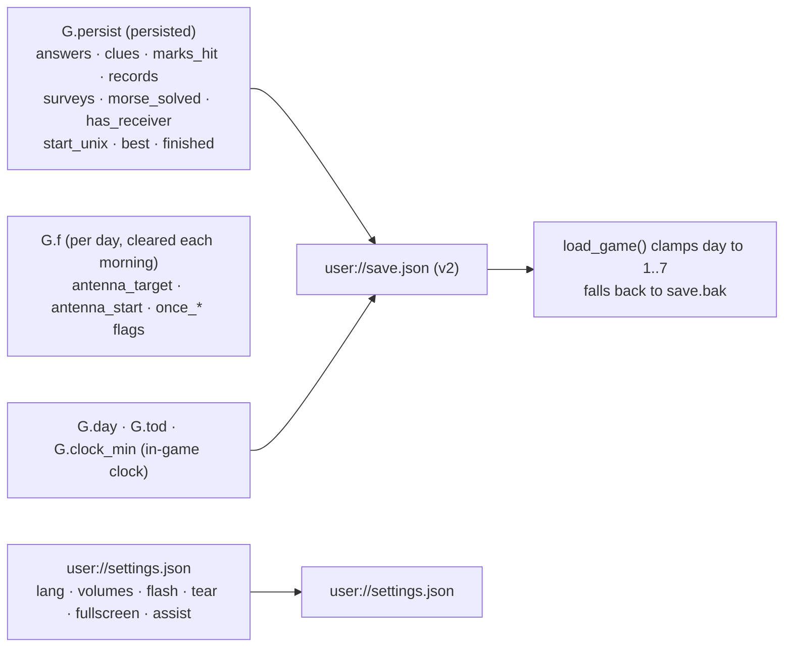
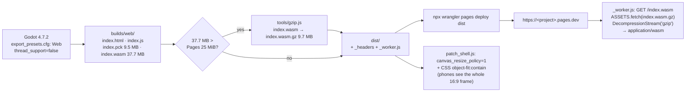
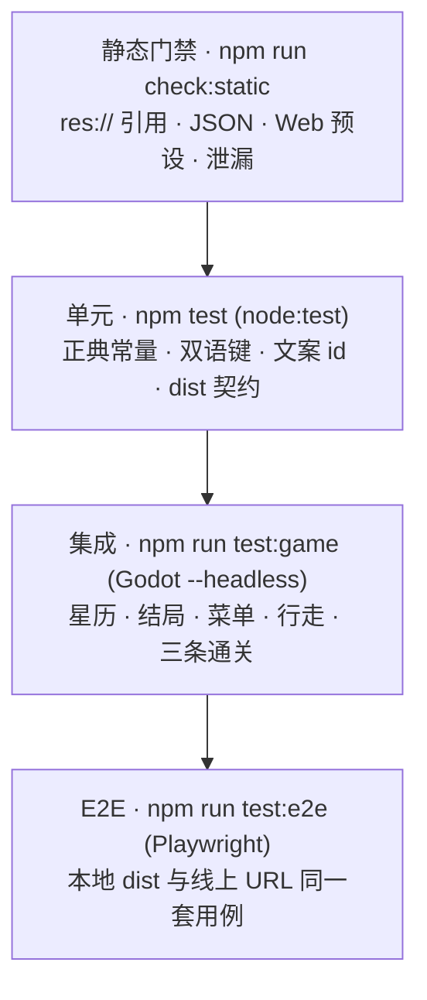

# Architecture

Three views: what runs on screen, what runs the story, and what turns this folder into a public URL.
The same diagrams exist as a standalone page in [`architecture-explainer.html`](architecture-explainer.html).

## 1. Render stack

One `Node` owns everything; every view is its own `SubViewport` so the pixel art and the shaders never argue about resolution.

Project settings that make this work: `640×360` viewport, stretch `viewport` + `keep` + integer scale, `gl_compatibility` renderer (so the same build runs on the web), nearest-neighbour texture filtering, 2D pixel snapping.

## 2. Mode router

`Main._input()` is the only place that decides who gets a key.

| mode | 拿到输入的模块 | 说明 |
| --- | --- | --- |
| `menu` | `menu.gd` | Esc 暂停、设置、语言 |
| `world` | `world.gd` / `flow.gd` | A/D 走，E 交互，Esc 暂停（面板打开时 Esc 归面板） |
| `desktop` | `desktop.gd` | XP 桌面：双击图标、拖动窗口、键盘输入汇报 |
| `dream` | `minigame.gd` | 第 5 天梦境里的 The Gift of X |
| `cutscene` / `ending` | `flow.gd` | 只响应「加速独白」 |

## 3. Day loop (director)

`Flow.start_day(n)` builds the day; every interaction is a `match` on the step, so the story cannot skip a beat.

Interactables that feed the mystery (all optional, none blocking): 告示牌、设备登记簿、书架、衣架、冰洞、回波测绘（`_open_sonar`）、摩斯电台（`_use_radio`）、档案（`app_archive.gd`）。
Endings are decided in one place: `G.can_escape()` = 摩斯编号已解 **且** 线索 ≥ 8/10；第 5 天被机房人影抓到则走 `assimilate`，其余到岸者 `sacrifice`。

## 4. State and save

Single slot, written atomically (`save.json.tmp` → `save.bak` → `save.json`), version 2.

On the web these land in the browser's IndexedDB via Godot's `user://` mount — no server, no account.

## 5. Build → deploy pipeline

Why a worker at all: **Pages caps a single stored asset at 25 MiB**; the engine wasm is 37.7 MB and cannot be split. Serving it gzipped keeps every stored file under the limit, and the worker inflates it for the browser. The first attempt returned the gzip bytes with `Content-Encoding: gzip`; `wrangler pages dev` compressed them a second time and the engine failed with `expected magic word 00 61 73 6d, found 1f 8b 08`, so the worker now decompresses explicitly — see `docs/user-feedback.md` issue I2.

## 6. Test layers

The dependency arrow is the point: a broken `res://` path fails in under a second, long before a 12-minute playthrough would.
